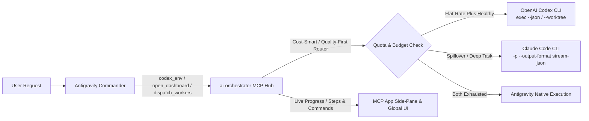

# AI Orchestrator

[Google Antigravity](https://antigravity.google) 插件（MCP Server + MCP App + Skill + Rules）：让 **Antigravity 作为总指挥（Commander）**，并行调度你本机已登录的 **OpenAI GPT/Codex（ChatGPT Plus / Pro 订阅）** 与 **Claude Code（官方订阅或 Static/中转站 API）** 子代理，配备 **Codex Desktop 风格的实时双栏进度条看板**、**零消耗额度遥测**、**自动成本与质量路由** 以及 **USD 预算防爆机制**。

> An Antigravity MCP App plugin that orchestrates parallel **GPT/Codex** and **Claude Code** subagents with a live Codex-style side-pane dashboard, zero-token quota telemetry, cost-smart / quality-first routing, USD budget guardrails, Git worktree isolation, and cross-engine failover.

---

## 架构概览 (Architecture)



---

## 核心特性 (Features)

- **双引擎协同（GPT/Codex + Claude Code）**：复用你本机 `~/.codex` 与 `~/.claude` 的现有登录态或 Static API 配置，无需额外中转层或逆向网页版。
- **Codex Desktop 风格双栏看板**：
  - 左侧线程栏按「活跃中 / 历史会话」分组，实时显示每个子代理的引擎标签（`GPT` / `Claude`）、进度条、耗时与花费；
  - 右侧主舞台还原 `STEPS_COMMANDS` 轨迹视图（思考、命令、变更文件、Markdown 回复渲染），支持点击变更文件直接在 Antigravity 打开，并在底部输入框**直接对任意子代理原会话续接追问**（`resume_worker`）。
- **零 Token 消耗检测 GPT Plus 额度**：读取 `~/.codex/sessions/.../rollout-*.jsonl` 中的官方 `rate_limits` 遥测，实时展示 **5 小时窗口** 与 **7 天窗口** 剩余比例与重置时间。
- **4 种智能路由策略 & 额度保护**：
  - `cost-smart`（默认省钱优先）：优先用包月 GPT Plus，耗尽或限流时自动溢出到 Claude API；
  - `quality-first`（质量优先）：深度架构/重构/排查优先派给 Claude（`opus` / `sonnet`），轻量调研和 Code Review 派给 GPT；
  - `codex-only` / `claude-only`：锁定单一引擎；
  - 结合任务复杂度（`fast` / `balanced` / `deep`）与剩余额度自动选档降档。
- **Claude Static API USD 预算护栏**：强制透传 `--max-budget-usd` 限制单任务上限（默认 `$1.50`），并统计当日累计花费（默认上限 `$5.00`，达 `70%` 自动从 Opus 降档到 Sonnet）。
- **并发防冲突 & 跨引擎容灾**：多个写文件子代理并行时自动启用 Git `--worktree` 隔离；任一引擎遇到限流/额度错误自动指数退避或故障切换到另一引擎；双引擎都不可用时无缝切回 Antigravity 原生执行。

---

## 环境要求 (Prerequisites)

1. **Google Antigravity**（桌面端或 IDE）
2. **Node.js** `>= 18`（已测试 `v24.x`）与 **Git**
3. 至少配置以下其一（或两者都配）：
   - **Codex CLI**（随 Codex Desktop 自带或 `npm i -g @openai/codex`），已登录 ChatGPT 账号
   - **Claude Code CLI**（`npm i -g @anthropic-ai/claude-code`），已通过官方 OAuth 登录或在 `~/.claude/settings.json` 配好 `ANTHROPIC_BASE_URL` / `ANTHROPIC_AUTH_TOKEN`

---

## 快速安装 (Quick Start)

```bash
git clone https://github.com/NHNDeu/ai-orchestrator.git
cd ai-orchestrator
npm install
npm run install:plugin
```

`npm run install:plugin` 会自动构建单文件服务端与内嵌前端 bundle（`dist/server.cjs`、`dist/dashboard.html`），并安装到 `~/.gemini/config/plugins/ai-orchestrator/`。

安装完成后：
1. 在 Antigravity 的 **MCP Servers / Customizations** 中启用或刷新 **`ai-orchestrator`**；
2. 点击左侧边栏或右侧辅助栏 **`+`** 菜单中的 **AI Orchestrator** 即可打开实时看板。

---

## 路由策略与默认配置 (Routing & Configuration)

| 配置项 | 默认值 | 说明 |
| --- | --- | --- |
| `routingStrategy` | `cost-smart` | `cost-smart` / `quality-first` / `codex-only` / `claude-only` |
| `autoOrchestrate` | `true` | 开启后遇到多模块/可并行工程任务自动调度外部子代理 |
| `autoFallback` | `true` | 一方遇到限流、额度或鉴权异常时自动切换至另一引擎重试 |
| `maxConcurrency` | `3` | 全局并发槽位上限（可在看板 `1~6` 调节，低额度时自动收敛） |
| `claudeMaxTaskBudgetUsd` | `1.5` | 单个 Claude 任务最高花费上限（USD） |
| `claudeDailyBudgetUsd` | `5.0` | Claude 每日总花费上限（USD） |

---

## 暴露的 MCP 工具 (MCP Tools)

### 模型调用工具（6 个）
| 工具名 | 作用 |
| --- | --- |
| `open_dashboard` | 打开 / 刷新 AI Orchestrator 双引擎进度看板（注册 `aux_pane` 与 `global` 入口） |
| `dispatch_workers` | 批量并行派发 GPT 或 Claude 子代理（支持 `engine: "auto"`、`effort: "auto"`、`steps`、`worktree`） |
| `workers_status` | 阻塞/非阻塞等待并读取进度、Token/USD 消耗、变更文件与最终输出 |
| `resume_worker` | 基于保存的 `threadId` / `session_id` 原会话续接追问 |
| `cancel_worker` | 取消单个或全部运行/排队中的子代理（含 Windows 进程树清理） |
| `codex_env` | 零消耗检测本机 Codex CLI / Plus 额度与 Claude CLI / 花费状态 |

### 看板专属交互工具（6 个，`visibility: ["app"]`）
`app_state` · `app_cancel` · `app_retry` · `app_dispatch` · `app_settings` · `app_clear`

---

## 本地校验 (Development & Verification)

```bash
npm run typecheck
npm run build
npm run verify            # 协议、工具名长度(<=64)、UI 资源与环境检查
node scripts/verify.mjs --full   # 额外执行一次真实的只读 Claude 子代理端到端测试
```

---

## 安全与隐私 (Security & Privacy)

- 插件**不存储、不复制、不上传**任何 API Key、OAuth Token 或账号凭据；
- 所有鉴权均直接复用你本机已有的 `~/.codex/` 与 `~/.claude/` 环境，且只在本地以子进程方式运行官方 `codex` / `claude` CLI。

---

## License

[MIT](./LICENSE)
